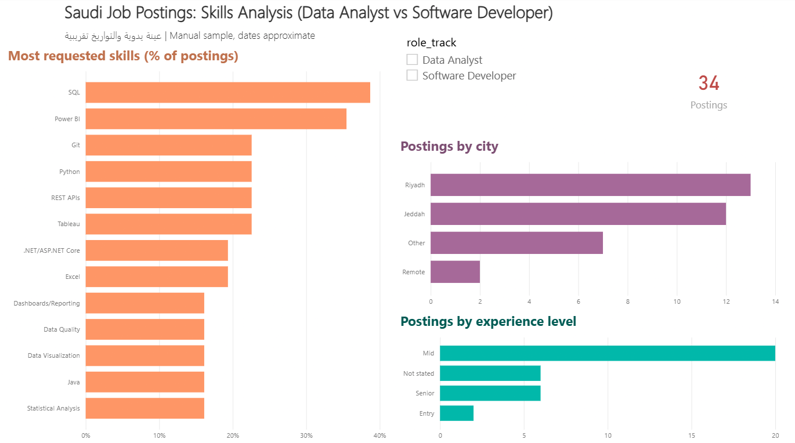

# Saudi Job Postings: Skills Analysis (Data Analyst vs Software Developer)

A small, hand-collected analysis of 34 job postings in Saudi Arabia, built to see which skills employers ask for in two tracks: **Data Analyst** and **Software Developer**.

**Tools:** Excel (collection template with data validation), Power Query (cleaning and skill normalization), Power BI (dashboard, DAX).

## Question
Which skills and tools appear most often in entry-to-senior Data Analyst and Software Developer postings, and where are the postings located?

## Data
- **Sample:** 34 postings (17 Data Analyst, 17 Software Developer).
- **Collection period:** 2026-10-26 to 2026-11-26.
- **Sources:** LinkedIn, Sabbar and Bayt. Postings were collected by hand. No scraping, and full ad texts are not copied.
- **Fields:** role track, job title, city, experience level, required skills, posting date, source, link.
- **Experience level rule (minimum years stated):** 0-1 = Entry, 2-4 = Mid, 5+ = Senior, otherwise Not stated.

## Method
1. Collected postings in an Excel template with validated lists for track, city and level.
2. In Power Query: split the comma-separated skills into rows, trimmed them, and merged spelling variants (for example, "reporting/dashboards" and "dashboards/reporting").
3. In Power BI: linked the postings table to the skills table (one-to-many) and built a `Skill %` measure = postings that mention the skill / postings with stated skills in the selected track.
4. The dashboard refreshes when new rows are added to the Excel file.

## Main findings (sample only)
- **Data Analyst:** Power BI appears in 10 of 17 postings, SQL in 8, Tableau in 7, Excel in 6.
- **Software Developer:** REST APIs in 7 of 14 postings with stated skills, .NET / ASP.NET Core in 6, Git in 6, Java in 5.
- **Cities:** Riyadh 13, Jeddah 12, other cities 7, remote 2. Makkah and Taif had no postings in this sample.
- **Levels:** Mid is most common (20 of 34). Only 2 postings were Entry level, both Data Analyst.

## Limitations
- Small, non-random sample collected by hand. It is **not** a picture of the whole Saudi market.
- Posting dates are **approximate**: LinkedIn shows relative dates (for example "2 days ago"), which I converted to a date. A few postings may have been older than a month.
- Some postings may have closed since collection.
- Some companies posted more than one role in the sample (for example 700apps, Emdad and Al-Muammar), so postings are not fully independent.
- Skills are taken from ad text as written. Some ads did not list skills clearly (marked Not stated).

## Files
- `job_postings_v7.xlsx`: collected data and the "how to fill" rules.
- `job_postings_dashboard.pbix`: Power BI dashboard.
- `job_posting_dashboard.png`: dashboard screenshot.

## Next steps
Add Makkah and Taif postings, and re-run the dashboard on a larger sample.
